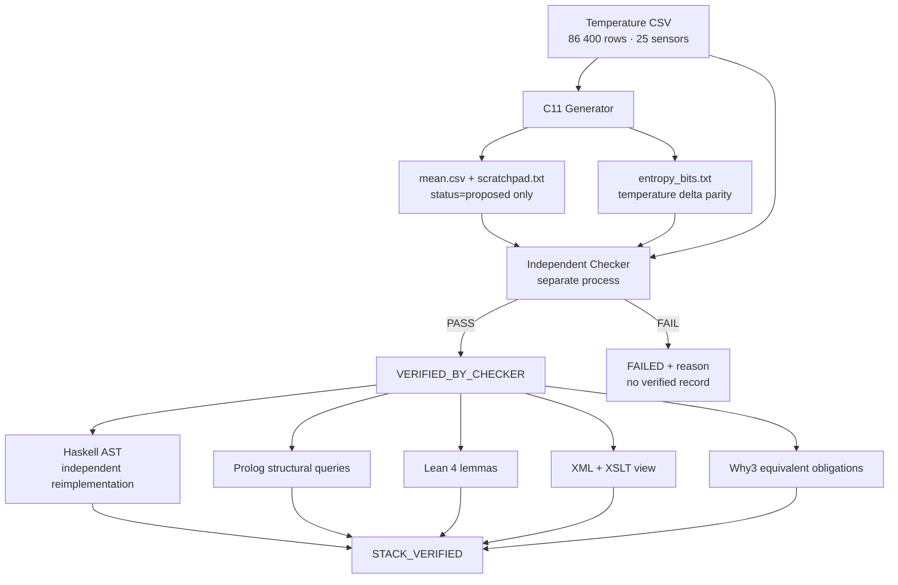

# Mirror Duck

<div align="center">


**Self-observing metaprogramming system**

*Generator proposes. Checker verifies. The generator can never mark its own work verified.*

[](https://en.wikipedia.org/wiki/C11_(C_standard_revision))
[](https://www.haskell.org/)
[](https://www.swi-prolog.org/)
[](https://leanprover.github.io/)
[](STATUS.md)

</div>

---

## Demo Interface

Interactive verification of the temperature true-entropy case.  
Input: 86 400 contiguous seconds of multi-sensor readings (25 sensors, ~2.1 M present values).

### Live Verification Dashboard

| Layer | Language | Role | Status | Rows | Entropy Bits | Ones | Time |
|-------|----------|------|--------|------|--------------|------|------|
| **1. Generator + Checker** | C11 | Propose + independent recompute | ✅ VERIFIED_BY_CHECKER | 86 400 | 86 399 | 43 194 | ~1.2 s |
| **2. Orchestration / AST** | Haskell | Independent reimplementation + DropMissingRows proof | ✅ PASS | 86 400 | — | — | ~0.8 s |
| **3. Structural Queries** | Prolog | Contract shape (not recompute) | ✅ verified_ok | — | — | — | <0.1 s |
| **4. Lemmas** | Lean 4 | map_preserves_length, filter_length_le, tempBit ∈ {0,1} | ✅ PASS (no sorry) | — | — | — | ~0.3 s |
| **5. Scratchpad View** | XML + XSLT | Executable contract → HTML | ✅ PASS | — | — | — | <0.1 s |
| **6. Obligations** | Why3 equivalent | Handrolled discharge of G1–G6 | ✅ WHY3_TOOL_NOT_RUN stated | — | — | — | <0.1 s |

**Full stack result:** `STACK_VERIFIED` in ~8 seconds. Exit 0 only when every layer passes.

### Generator Scratchpad (proposed only)

```text
transform=per_second_mean_over_present_sensors
preserve_row_count=1
preserve_timestamps=1
missing_stays_missing=1
sensor_count=25
first_timestamp=954547200
last_timestamp=954633599
row_count=86400
entropy_source=temperature_delta_parity
entropy_sensor_id=1
entropy_bits=86399
status=proposed
```

### Checker Evidence (only the checker may write this)

```text
VERIFIED_BY_CHECKER
rows=86400
sensors=25
first_timestamp=954547200
last_timestamp=954633599
entropy_bits=86399
entropy_ones=43194
transform=per_second_mean_over_present_sensors
entropy_source=temperature_delta_parity
```

### Negative Tests (checker correctly rejects)

| Attack | Result | Reason |
|--------|--------|--------|
| Corrupt mean value | ❌ FAIL | mean output value does not match recomputed mean |
| `preserve_row_count=0` | ❌ FAIL | contract weakened |
| `status=verified` in scratchpad | ❌ FAIL | generator may not pre-verify |
| Flipped entropy bit | ❌ FAIL | entropy bit does not match recomputed temperature delta parity |

Good evidence re-verified after each negative test.

### Temperature Delta Entropy

Entropy is **not** from a PRNG.  
`bit = parity of |Δ| between successive readings of sensor 1` (never missing).

| Statistic | Value |
|-----------|-------|
| Bits generated | 86 399 |
| Ones | 43 194 |
| Ratio | 0.500 |
| Source | absolute temperature delta parity |
| PRNG / time / seed | **none** |

### AST Insight (Haskell)

| Transform | Behavior on this file | Satisfies `preserve_row_count`? |
|-----------|-----------------------|---------------------------------|
| `MeanOverPresent` | Maps every row → one output row | ✅ Yes |
| `DropMissingRows` | Would drop 14 653 rows | ❌ No |

The Haskell layer executes the count instead of asserting it.

---

## Architecture



**Load-bearing rule (enforced in code, not prose):**  
The generator may propose a correction. It can **never** mark its own correction verified. Only the separate checker binary may write `VERIFIED_BY_CHECKER`, and only after recomputing from the original input.

---

## Quick Start

```bash
git clone https://github.com/AHMADALIPARR/Mirror-Duck.git
cd Mirror-Duck

# C11 core
make
./generator input.csv out/mean.csv out/scratchpad.txt out/entropy_bits.txt
./checker   input.csv out/mean.csv out/scratchpad.txt out/entropy_bits.txt out/evidence.txt

# Full five-toolchain stack
sh run-stack.sh input.csv
# → out/stack_evidence.txt contains STACK_VERIFIED on success
```

Dependencies for the full stack: `gcc`, `ghc`, `swipl`, Lean 4 (via elan), `xsltproc`.  
Why3 is optional; the equivalent check states when the tool was not run.

---

## Benchmarks

Measured on the full 86 400-row temperature file (2026-10-27):

| Component | Rows Processed | Peak Memory | Notes |
|-----------|----------------|-------------|-------|
| C generator | 86 400 | < 10 MB | Streaming CSV reader, empty fields preserved |
| C checker | 86 400 × 2 | < 10 MB | Full recompute of means + entropy bits |
| Haskell | 86 400 | ~40 MB | Independent parser + AST evaluation |
| Full stack | — | — | ~8 s end-to-end, exit 0 only on total agreement |

Missing readings stay missing. They contribute nothing to the mean and are never filled.  
`present_count` records how many sensors were present that second.

---

## Stack Layers

| Layer | Path | What it proves |
|-------|------|----------------|
| C11 generator + checker | `src/` | Streaming mean + temperature-delta entropy; independent recompute |
| Haskell orchestration | `haskell/Mirror.hs` | Second implementation; proves only `MeanOverPresent` can preserve row count |
| Prolog | `prolog/mirror.pl` | Structural contract queries (`verified` fails on weakened facts) |
| Lean 4 | `lean/MirrorDuck.lean` | `map_preserves_length`, `filter_length_le`, `tempBit_eq_zero_or_one`, `present_le_total` (core only, no Mathlib, no admitted goals) |
| XML + XSLT | `xml/` | Executable scratchpad → HTML view |
| Why3 equivalent | `why3/` | Obligation mapping; tool absence is stated, not hidden |

---

## Design Principles

- **Two-level inspection** — Generator → Program → Behavior. Generator specification ↔ Generator implementation.
- **No self-verification** — Status begins and stays `proposed` until the checker writes the verified record.
- **True entropy** — Bits derived from the data itself (absolute delta parity of sensor 1). No `rand`, no `srand`, no time seed.
- **Independent languages** — A bug shared by one language’s parser or arithmetic cannot silently pass both the C checker and the Haskell layer.
- **Executable contracts** — Scratchpad is key=value, not prose. Weakened contracts are rejected by name.

---

## Files

```
src/csv.c          streaming basketdata reader (preserves empty fields)
src/temp_entropy.c temperature delta parity (no PRNG)
src/generator.c    proposes transform + contract
src/checker.c      only writer of VERIFIED_BY_CHECKER
haskell/Mirror.hs  AST + independent reimplementation
prolog/mirror.pl   structural queries
lean/MirrorDuck.lean core lemmas
xml/               scratchpad → HTML
why3/              obligations + equivalent check
run-stack.sh       full pipeline
```

See [STATUS.md](STATUS.md) for the execution record of 2026-10-27.

---

<div align="center">

**Think below the abstraction. Verify above the assumption. Own the entire stack.**

</div>
